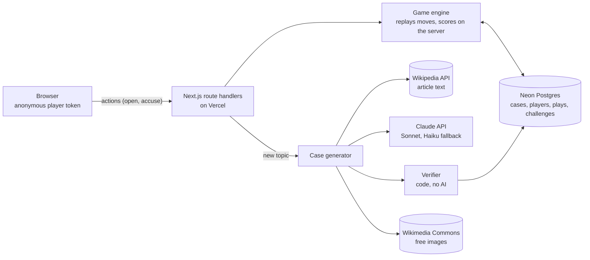

# Daily Case

A real history or science mystery to solve every day. Open sealed clues, rule out the wrong theories and name the answer, and every clue quotes a real source that code has checked word for word.

**Live:** https://business-cup-2-azure.vercel.app (no sign-up, works on phones)

Built in 24 hours for the Zimran x AIESEC Business Cup 2.0 (web, B2C, Entertainment track).

## What it is and for whom

US adults (25-45) lose evenings to doomscrolling and want downtime that leaves them knowing something. A chatbot can tell them a story, but it plays alone, improvises and can't prove its facts. Daily Case is the opposite: the same case for everyone each day, fixed rules with server-computed scoring, and clues that come from real articles, verified by code before anyone sees them.

- **Free:** today's case every day, streaks, detective ranks, leaderboards, "Challenge a friend" links and one new case on any topic.
- **Plus ($6.99/month or $49.99/year):** unlimited new cases on any topic, the full case archive and personal stats. Each new case costs real AI and verification work; Plus pays for it. Cancel in one click.
- **Why people come back:** a new case at midnight New York time, a streak, a rank to climb (Rookie to Chief) and friends to beat.

## Try it in 60 seconds

1. Open the live link and press **Start the investigation** on today's case. Read the three-panel briefing (or skip it).
2. Read the two opening clues: each quote carries a **Verified quote** stamp and links to its Wikipedia article.
3. Open a sealed file (−100 points) and accuse a theory. A wrong accusation costs a life and reveals the clue that rules it out.
4. Name the answer: the verdict, the closing panel, a rank promotion and the solution with every claim linked to its clue. Press **Create a challenge link** and open it in a private window to play as a second player; results stay sealed until that player finishes.
5. Back home, type any history or science topic and watch the case being built and verified live (about 30 seconds), or tap a ready topic for an instant case.
6. Open **Plans and pricing**, take the demo checkout (no payment), open the archive, then cancel in **Settings** with one click.

Short on time? [`/demo`](https://business-cup-2-azure.vercel.app/demo) (also `/?demo=1`) is a guided tour of the same path on a sample case. It plays by script on the server and saves nothing.

## How it works



- **Generation** (`src/lib/case`): topic → safety check (Claude Haiku) → Wikipedia search and article text → Claude Sonnet drafts a case as structured JSON (8 clues, 4 theories, solution) → code verification → targeted repairs of only the failing parts (at most 2 rounds) → stored. Then archive images and comic-panel narration are added. The progress streams to the browser.
- **Verification is code, never an LLM** (`src/lib/case/verify.ts`): every quote must appear in the source text after normalizing case, whitespace, quote marks and dashes; ellipses are rejected; every wrong theory must be refuted by at least one clue; the right one supported by at least two and refuted by none; opening clues can't settle the case. A case that still fails after repairs is discarded.
- **Images** (`src/lib/sources/exhibits.ts`): only files hosted on Wikimedia Commons with a free license, large enough and not template art (flags, logos, icons). Each shows its author, license and file page.
- **Narration** (`src/lib/case/narration.ts`, `narrate.ts`): the intro captions are written from what the player sees at the start only, so the model never knows the answer; a check rejects any year or name the case doesn't contain and any invented dialogue. The closing caption reaches the browser only after the case ends.
- **Scoring on the server** (`src/lib/game`): the browser sends moves; the server replays the move log and computes lives and score (1,000 − 100 per opened file − 200 per wrong accusation; a case lost on lives scores 0). The answer, the solution and sealed clue text never reach the browser before the case ends, which the tests check.
- **No-login players** (`src/lib/player`): the first visit creates a player with a generated nickname and a secret token kept in the browser; only its hash is stored. Plays, streaks, ranks, leaderboards, plans and challenges hang off that player.
- **Challenges** (`src/lib/challenge`): one link per player and case. Anyone who opens it plays the same case as their own player; scores, grids and times are shown only to people who finished the case themselves, then side by side.

### Repo map

| Path | What lives there |
|---|---|
| `src/app` | Pages and API route handlers |
| `src/lib/case` | Case schema, generation pipeline, verification, narration, the client view |
| `src/lib/game` | Engine (replay and scoring), share grid, streak, rank, stats |
| `src/lib/sources` | Wikipedia client and Commons exhibits |
| `src/lib/ai` | Provider chain with timeouts and fallback |
| `src/lib/player`, `src/lib/challenge` | Anonymous identity, plans and access rules, challenge visibility |
| `src/lib/db`, `drizzle/` | Drizzle schema, queries and migrations |
| `scripts/cases.ts` | Generate, seed and backfill cases from the command line |

## Stack

Next.js 16 (App Router, Cache Components), React 19, TypeScript (strict), Tailwind CSS 4, Zod at every boundary, Drizzle ORM on Neon Postgres, the Anthropic TypeScript SDK, Vitest. Hosted on Vercel: `main` is production and every branch gets a preview. CI runs `npm run check` on every push and pull request; an Uptime workflow checks production every 5 minutes.

## Where AI is used, cost and fallback

| Step | Model | Notes |
|---|---|---|
| Topic safety check | Claude Haiku | Family-friendly topics only; refusals are polite and suggest ready cases. |
| Case draft and repairs | Claude Sonnet, falling back to Claude Haiku | Structured JSON output; the source articles are sent as a cached context block. |
| Comic-panel narration | Claude Haiku | Checked by code; falls back to the case's own words. |

A new case costs about $0.07 and takes 20-35 seconds; opening a case someone already generated costs nothing and is instant. Every model call goes through `src/lib/ai`: a per-call timeout, then the next provider in the chain on timeouts, rate limits, server or network errors. If generation still fails, the page explains why and offers ready cases. Budget guards: 3 new cases per hour per IP, 1 free new topic case per player, and a site-wide daily cap on new cases (`GENERATION_DAILY_CAP`); the provider-side spend cap is the hard limit.

## Data and licenses

- Clue quotes come from English Wikipedia, used under [CC BY-SA 4.0](https://creativecommons.org/licenses/by-sa/4.0/); every quote links to its article and the end screen links the exact revision quoted.
- Images come from Wikimedia Commons under their own free licenses; every image shows its author, license and file page.
- "The Archivist" narrator badge and all styling are original; no AI-generated images.

## Run locally

Requires Node 24 (`nvm use` reads `.nvmrc`) and a Postgres database (Neon works).

```sh
npm ci
cp .env.example .env.local   # fill in the values
npm run db:migrate
npm run dev                  # http://localhost:3000
npm run check                # lint, typecheck, test, build
```

Content scripts: `npm run cases:generate -- --topic "..." --kind topic|archive|daily`, `npm run cases:seed`, and `npm run cases:backfill` (adds images and narration to stored cases; `--only exhibits` needs no AI key). Smoke-check a deployment with `scripts/smoke.sh <base-url> [expected-commit-sha]`.

## Environment variables

See `.env.example`.

| Name | Purpose |
|---|---|
| `AI_PROVIDERS` | Ordered provider chain for case generation (default `claude-sonnet,claude-haiku`; `mock` for tests). |
| `AI_SAFETY_PROVIDERS` | Cheap provider chain for the topic safety check and comic-panel narration (default `claude-haiku`). |
| `ANTHROPIC_API_KEY` | Anthropic API key, used server-side only. |
| `DATABASE_URL` | Neon Postgres pooled connection string, used at runtime. |
| `DATABASE_URL_UNPOOLED` | Neon direct connection string for migrations (`npm run db:migrate`). |
| `GENERATION_DAILY_CAP` | Optional; brand-new topic cases the whole site may generate per New York day (default 40). Cached topics stay free. |
| `VERCEL_PROTECTION_BYPASS` | Optional; lets `scripts/smoke.sh` check protected preview deployments. |

## Known limitations

- One browser is one player: clearing site data starts a new player (and loses a demo plan). A transfer code between devices isn't built.
- Checkout is a clearly labelled demo that grants Plus without payment (Stripe isn't available to us); the Family plan is shown but not sold yet.
- New cases depend on Wikipedia and the Anthropic API being reachable; cached cases keep working without them.
- The per-IP limiter runs in memory per serverless instance, so it is best effort; the provider spend cap is the hard bound.
- Image picks rank by word overlap with the case, so an occasional exhibit is only loosely related.
- English only; the daily case changes at midnight New York time.

## Roadmap

- Co-op rooms with split clues: each player holds different evidence and the group has to talk it through.
- Friends and weekly leagues, and the Family plan's private league.
- More content packs (space, medicine, engineering failures, famous hoaxes) and an educator mode for classrooms.
- Real payments once a provider is available, and a cross-device transfer code.
